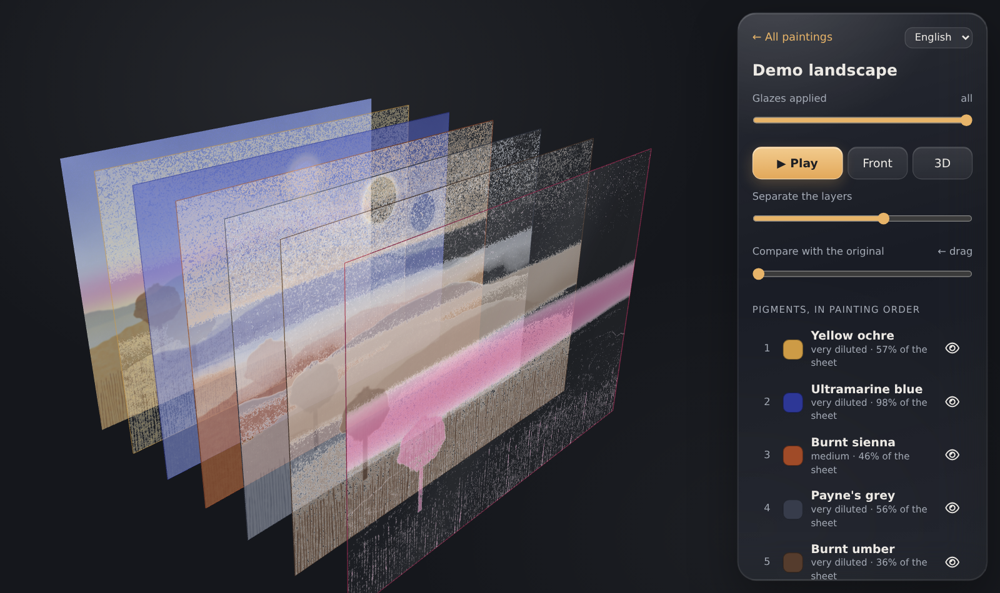

# Strativarious

**Break a watercolor down into its layers of color, and look at them in 3D.**

Take a photo of a watercolor and Strativarious estimates which pigments were glazed where and how
diluted, then lets you pull the glazes apart in 3D, replay them in order, isolate a pigment, or
compare the reconstruction with the photo. It runs entirely in the browser: nothing is uploaded.



## Use it

**Open the app: https://tcsenpai.github.io/strativarious/**, tap **Try it with the demo
painting**, or upload a photo of your own. It works on phones and can be installed as an app
(PWA, works offline).

It ships with **example palettes** (a 3-pigment triad, split primary, landscape, portrait and a
12-pan student set) built from typical colors of common pigments. For results that mean something,
**calibrate your palette** once: paint a small grid with each pigment at full strength, medium and very
diluted, photograph it, tap its four corners. The app learns your actual colors instead of guessing. Step-by-step guide for painters: [GUIDE.md](GUIDE.md)
(Italian: [GUIDA.md](GUIDA.md)).

Features:

- Pigment unmixing with a Kubelka-Munk model, per pixel, in parallel Web Workers (≈3 s for 1024 px).
- Palette calibration from a phone photo (perspective-corrected, normalized to the paper).
- 3D viewer: exploded layers, glaze-by-glaze playback, solo/hide pigments, before/after wipe.
  The glass styling never touches pigment colors: the backdrop is neutral, sheen only appears on
  unpainted parts of a layer, and the front view is the plain reconstruction. It only redraws when
  something changes, to spare phone batteries.
- Example palettes by size/budget, with pigment codes (PY97, PV19, PB15:3, …) to find them in a shop.
- Choose which pigments you actually used before decomposing (the strongest hint you can give).
- Warns when the photo has no bare paper (the paper color can't be estimated, colors would be shifted).
- Re-run a painting with another palette; combine pigments from any palettes into a *synthetic* palette.
- Export any result as a single self-contained HTML file (opens offline, can be shared).
- Export/import palettes as JSON to move them between devices.
- English and Italian.

## How it works

Watercolor is transparent and subtractive, so a glaze filters the light of the layers below.
Strativarious uses single-constant Kubelka-Munk per linear RGB channel:

$$\frac{K}{S}(\text{pixel}) = \sum_i c_i \, \frac{K}{S}_i, \qquad R = 1 + \frac{K}{S} - \sqrt{\left(\frac{K}{S}\right)^2 + 2\frac{K}{S}}$$

For every pixel it solves $\min_{c \ge 0} \lVert A c - k_{obs} \rVert^2 + \lambda \sum_i c_i$ (projected FISTA),
where the columns of $A$ are the calibrated pigments and the paper color is estimated from the
brightest pixels. The glaze **order** is a craft heuristic (broad and light washes first, dark details last).

### Honest limits

- This is an **ill-posed inverse problem**. RGB has 3 channels; with 6 pigments many mixtures produce the
  same color. You get *a* plausible sequence of glazes, not necessarily the one that was painted.
  Telling the app which pigments you actually used (checkboxes before decomposing) helps more than anything else.
- Pixels are solved independently (after a light 3x3 denoise). In areas where several mixtures fit equally
  well, diluted layers can look grainy. Spatial regularization is the most wanted improvement.
- Example palettes use typical, *estimated* pigment colors: brands and papers differ. Calibrate for real work.
- Wet-in-wet, blooms, granulation and lifting are events, not layers: they get explained as glazes anyway.
- Single-constant KM ignores scattering and opacity, so it works best for transparent pigments.
- The algorithm is validated on synthetic paintings with known layers (see `test/`), not yet against
  recorded painting sessions. Time-lapse recordings of real paintings would be very welcome.

## Develop

Requires [Bun](https://bun.sh).

```bash
bun install
bun run dev          # build + http://localhost:37041  (--lan to reach it from a phone)
bun test             # core tests (KM, solver, calibration geometry, pipeline on the demo, bundled palettes)
bun run build        # static site in dist/, deployable anywhere
bun run demo         # regenerate the procedural demo painting
```

The service worker (offline, install) only runs on `https` or `localhost`.
Pushing to `main` deploys `dist/` to GitHub Pages (`.github/workflows/pages.yml`):
enable *Settings → Pages → Source: GitHub Actions* once.

```
src/core/      color science, solver, pipeline, calibration geometry (pure, tested)
src/pages/     home, calibration, viewer pages
src/viewer/    Three.js viewer (also bundled into exported HTML)
src/static/    HTML, CSS, icons, manifest, demo images
palettes/      demo palette (procedural demo + tests) and example palettes
python/        numpy reference implementation + CLI
scripts/       demo painting generator, dev server
```

### Python reference / CLI

```bash
pip install -e "python[dev]"
pytest python
bun run build   # the CLI fills dist/standalone.html
strativarious photo.jpg --palette my-palette.json -o photo.html
```

## Prior work

- Curtis et al., *Computer-Generated Watercolor* (SIGGRAPH 1997): glazes as Kubelka-Munk layers.
- Tan, Lien, Gingold, *Decomposing Images into Layers via RGB-space Geometry* (TOG 2016).
- Tan, DiVerdi, Lu, Gingold, *Pigmento: Pigment-Based Image Analysis and Editing* (TVCG 2018).
- Sochorová, Jamriška, *Practical Pigment Mixing for Digital Painting* (Mixbox, SIGGRAPH Asia 2021).

## Acknowledgments

Default demo art by [dekugh](https://www.newgrounds.com/art/view/dekugh/zelda-ocarina-of-time-title-screen).
During development the algorithm was tried on a watercolor portrait from
[this Domestika project](https://www.domestika.org/it/projects/1863353-final-project).
The image is not part of this repository.

## License

[MIT](LICENSE). Bundles [three.js](https://threejs.org) (MIT). The procedural landscape demo
(`scripts/demo-painting.js`, `src/static/demo.png`) is covered by the same license.

**Not covered by the MIT license:** the default demo image `src/static/demo-ocarina.jpg` is
[“Zelda: Ocarina of Time title screen”](https://www.newgrounds.com/art/view/dekugh/zelda-ocarina-of-time-title-screen)
by **dekugh**, used with credit; all rights remain with the artist. *The Legend of Zelda* is a trademark of Nintendo.
Forks and redistributions should not assume they may reuse it.
